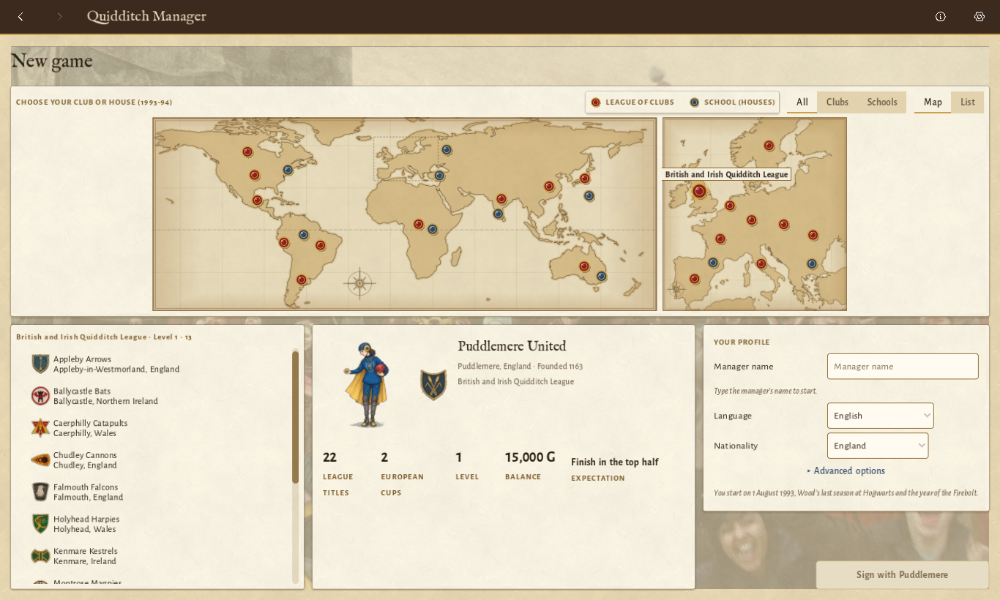
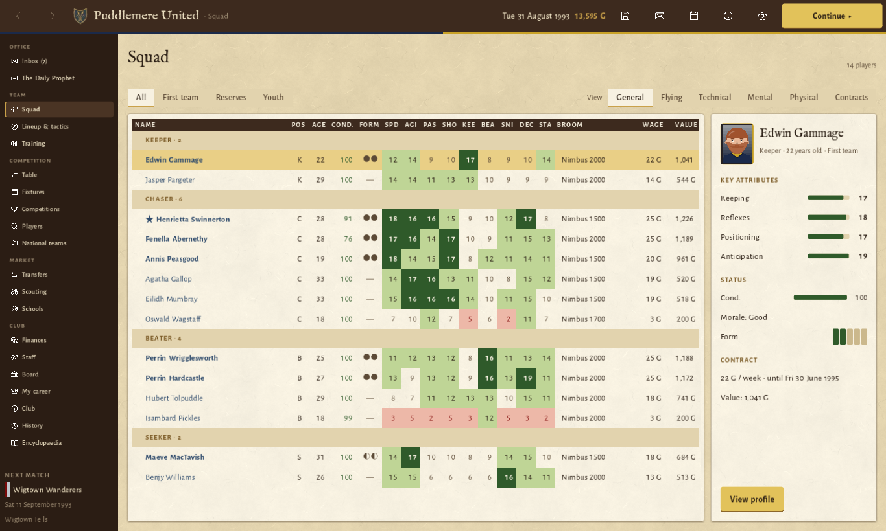
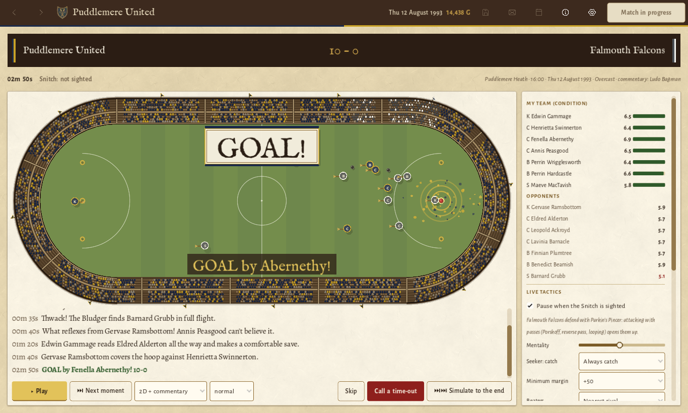
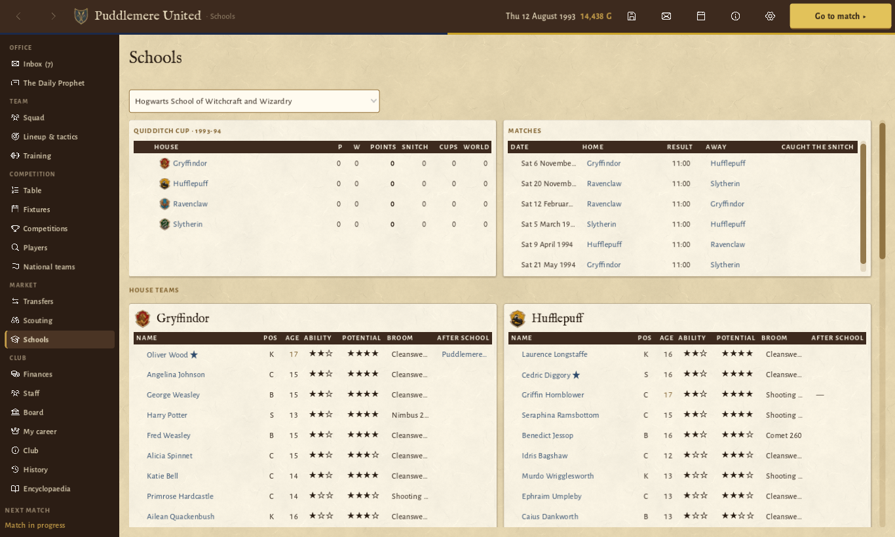
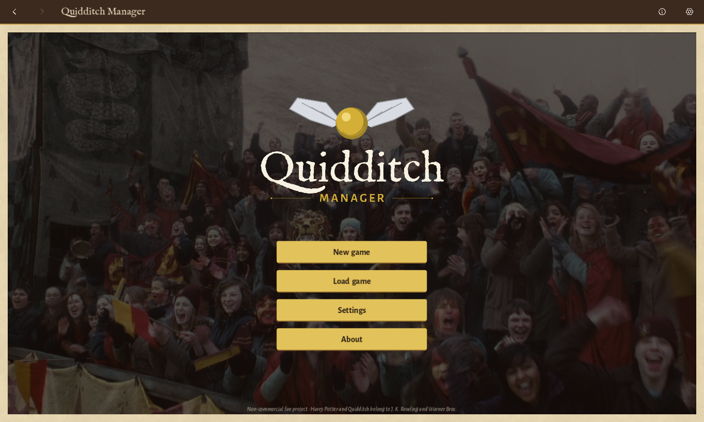

# Quidditch Manager

A Quidditch management game in the spirit of Football Manager 2007, built with Godot 4 and faithful to the
Harry Potter books and *Quidditch Through the Ages*. You take charge of a professional club (or a Hogwarts house) in
1993, pick the team and tactics, sign players, run the finances, and watch matches play out as text commentary or
on a top-down 2D pitch.

> **Fan project.** Free and non-commercial. Not affiliated with or endorsed by J.K. Rowling, Warner Bros.,
> Bloomsbury or Wizarding World Digital. Harry Potter and all related names belong to their owners.
> See [ATTRIBUTION.md](ATTRIBUTION.md).

Version 0.12.1, pre-release. Desktop builds (Windows and macOS) and the browser version come from the
[Releases](https://github.com/fergmolina/quidditch-manager/releases) page once the first one is tagged. The hosted
web version is not public yet.



## Features

- **A whole wizarding world.** 194 clubs in 20 leagues across every continent, national cups, the European Cup,
  continental cups and a Quidditch World Cup every four years with national teams.
- **Eleven wizarding schools** as youth academies. Hogwarts, Ilvermorny, Beauxbatons, Durmstrang, Castelobruxo,
  Uagadou, Mahoutokoro, Koldovstoretz and three invented ones. Each has four houses that play their own House Cup,
  and you can manage a house instead of a club.
- **FM 2007-style player model.** Attributes from 1 to 20 (technical, mental, physical, flying and position-specific),
  current and potential ability, hidden attributes, growth and decline with age, training and match time.
- **Deterministic match engine.** `(teams, tactics, seed) → event log`. Matches the player doesn't watch are
  simulated instantly. The 2D viewer and the commentary are replays of that log. Canon tactics like the Wronski
  Feint, Hawkshead Attacking Formation, Porskoff Ploy or Dopplebeater Defence are tactical instructions.
- **Management.** Transfers, loans and contract talks, scouting, training, staff, board objectives, finances, press
  conferences, team talks, *The Daily Prophet* and owl post.
- **Ten languages.** Spanish, English, German, French, Italian, Brazilian Portuguese, Dutch, Russian, Japanese and
  Simplified Chinese, using the official terminology of each edition of the books.
- **Canon first.** Everything that is not in the books is marked as invented in the data (`source: "filler"`) and
  in the docs (`[FILLER]`), so it is easy to review or replace.

| | |
|---|---|
|  |  |
|  |  |

## Running the game

You need [Godot 4.7](https://godotengine.org/download), the standard build, since the project is GDScript only (no C#).

```sh
git clone https://github.com/fergmolina/quidditch-manager.git
cd quidditch-manager
godot --headless --path . --import   # first time only: imports assets
godot --path .                       # play
```

Or open `project.godot` in the Godot editor and press F5.

Shortcuts: Space = Continue, Ctrl+S (Cmd+S on a Mac) = quick save, F1 = help for the current screen, Alt+←/→ or the mouse side buttons = back/forward.
Language, text size and density are in Settings (gear icon in the top bar).

Saves are stored in `~/Library/Application Support/Godot/app_userdata/Quidditch Manager/saves/` (macOS),
`%APPDATA%\Godot\app_userdata\Quidditch Manager\saves\` (Windows) and
`~/.local/share/godot/app_userdata/Quidditch Manager/saves/` (Linux).

## Online play: the free account and what we store

The desktop versions (Windows, macOS) and a copy you run yourself need no account and send nothing anywhere. The
browser version on the game's website asks you to create a free account first. You sign in with Google or with a link
sent to your email (there are no passwords), then pick a username and your country.

What the server keeps, and nothing else:

- Your email address, only to sign you in. It is never shown in the game or to other players.
- Your username (public) and your country.
- Optionally, your first and last name (never public), and your region and city from a list of places, for a
  future map of players.
- Which version of the terms you accepted and when, and the dates you created the account and last signed in.
- Your sessions (one per device): when they started and were last used, and a rough browser name such as
  "Firefox · Windows". The server stores no IP address with your account. Abuse limits use a keyed hash of your
  network address, deleted within a day.
- One short summary per finished season of each career you play in the browser (reputation, club, titles,
  seasons managed), for a future ranking overall and by country. The server flags implausible summaries and leaves
  them out.
- What you send through the feedback form at `/feedback` (bug or idea, your message, an optional reply address),
  kept for 12 months. The form needs no account. The game's About box links to it.
- Whether and when your account was approved, during a closed trial where the operator lets players in by hand;
  the operator is then told about each sign-up through Telegram, with your username and country only.

Your saves stay in your browser and in the files you download. They are never uploaded. There is no analytics,
advertising or tracking, and only the cookies needed to stay signed in and remember your language. On your account
page you can download everything stored about you, change it, sign out of other devices and delete the account at
once. Deleted data leaves the backups within 45 days. The full text is the privacy policy
([server/legal/privacy.en.md](server/legal/privacy.en.md), shown on the site at `/privacy`) and the terms of use
([server/legal/terms.en.md](server/legal/terms.en.md), at `/terms`). The design is in
[docs/design/12-web-version.md](docs/design/12-web-version.md). To report a security problem, see [SECURITY.md](SECURITY.md).

## Tests

```sh
godot --headless --path . -s tests/run_tests.gd
```

More developer tools (world simulation, stress tests, balance checks, UI tour, screenshots) are listed in
[CONTRIBUTING.md](CONTRIBUTING.md).

## Building installers

Install the Godot 4.7.2 export templates. Only `macos.zip` and `windows_release_x86_64.exe` are needed. Then:

```sh
bash tools/make_dmg.sh                                                     # macOS: export/QuidditchManager.dmg
godot --headless --path . --export-release "Windows" export/windows/QuidditchManager.exe
```

- **macOS.** Universal (Intel and Apple Silicon), signed ad hoc but not notarized. The first time, right-click the
  app, choose Open, then Open again, or run `xattr -cr "/Applications/Quidditch Manager.app"`.
- **Windows.** A single `.exe` with the game data embedded and the Snitch icon (`assets/icon.ico`). SmartScreen warns
  about an unknown publisher: choose "More info", then "Run anyway".

## Project layout

| Path | Contents |
|---|---|
| `src/sim/` | Match engine: pure, deterministic, no scene nodes. |
| `src/world/` | World model: clubs, players, competitions, schools, world generation. |
| `src/game/` | Game rules over time: season engine, economy, transfers, progression, news, saves. |
| `src/ui/` | Interface: main shell, screens, widgets, theme, 2D match viewer. |
| `data/` | Editable JSON data pack (1993-94 season): clubs, players, competitions, schools. See [data/README.md](data/README.md). |
| `locale/` | UI strings in 10 languages (`strings.csv`, per-language sources in `locale/tr/`). |
| `assets/` | Fonts, icons, crests, portraits, broomsticks, sounds, maps. |
| `tools/` | Generators, importers, simulations and audits. |
| `tests/` | Engine and world tests. |
| `docs/` | Research, game design documents, art prompts. See [docs/README.md](docs/README.md). |
| `server/` | Accounts service for the browser version (Node + TypeScript): sign-in, profiles, privacy and terms pages. See [server/README.md](server/README.md). |
| `deploy/` | Server deployment: Compose, Caddy, Postgres, backups. Variable names only, never values. |

## Contributing

Bug reports, translations and canon corrections are welcome. Please read [CONTRIBUTING.md](CONTRIBUTING.md) first.

## License

Code, data and original assets: [MIT](LICENSE). This does not grant any rights to Harry Potter intellectual
property. Third-party fonts and icons keep their own licenses, and a few third-party images (the title background, the
World Cup trophy, and AI artwork based on Emily Gravett's club patches and the Hogwarts house crests) are not covered
by it (see
[ATTRIBUTION.md](ATTRIBUTION.md)).
